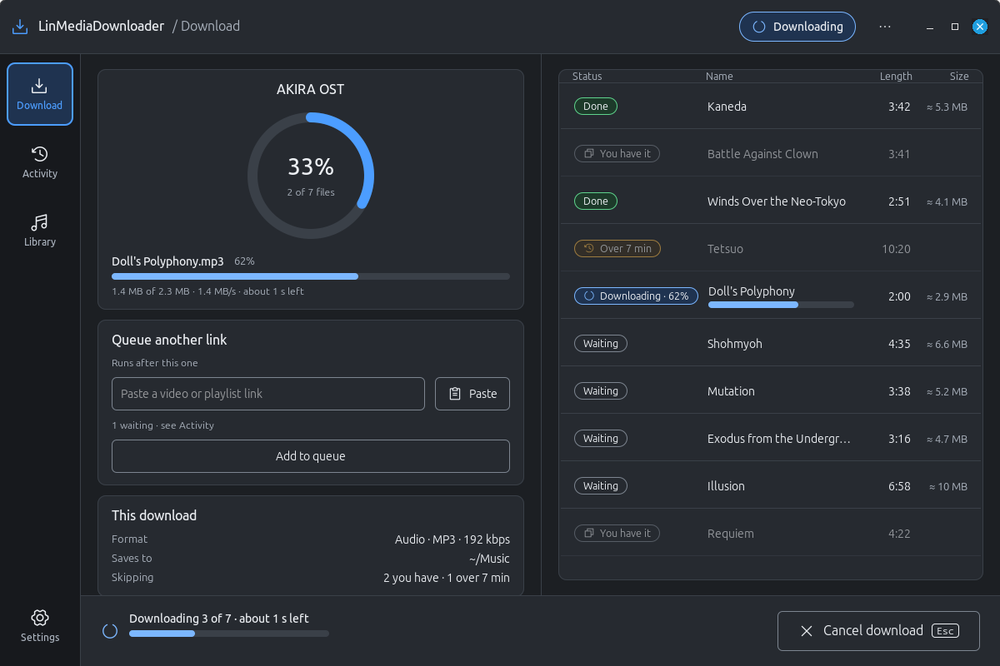
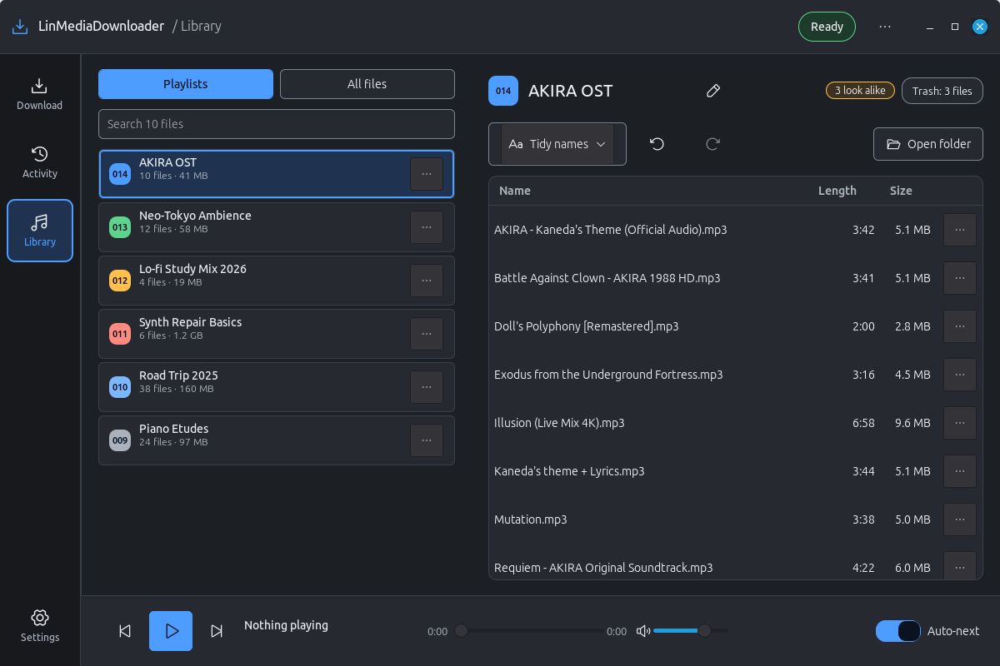
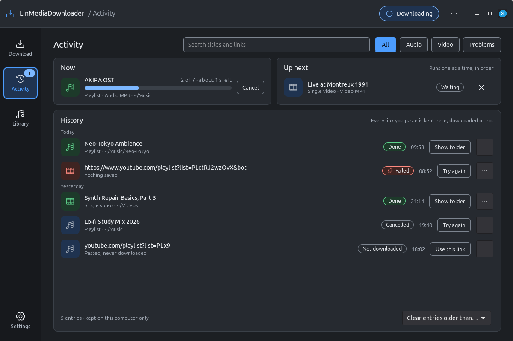
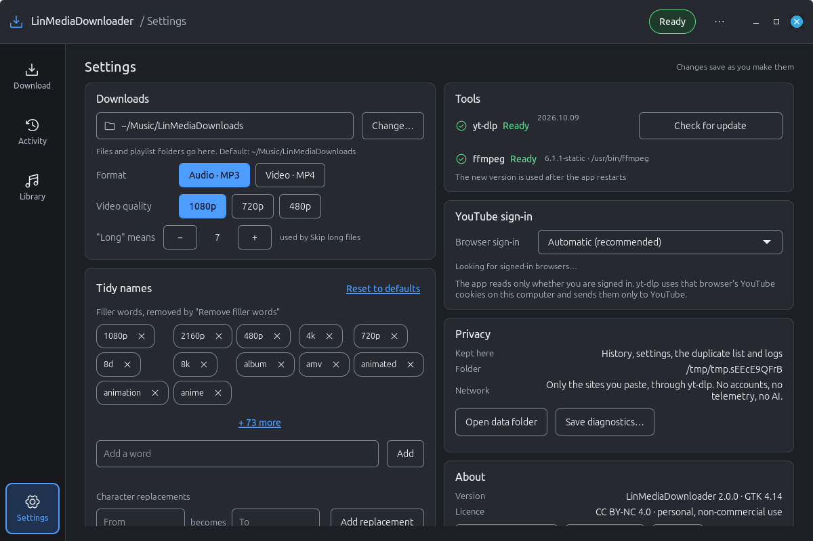

# LinMediaDownloader

**LinMediaDownloader** is a native GTK 4 desktop app for Linux that downloads music, videos
and whole playlists (currently from YouTube) for personal, non-commercial use, and keeps the
results tidy. Downloading is done by the excellent [**yt-dlp**](https://github.com/yt-dlp/yt-dlp).



---

## ⚡ Install

For **Debian, Ubuntu and Linux Mint** (GTK 4.10 or newer: Mint 22, Ubuntu 24.04, Debian 13).
Pick one of three ways. Each adds **LinMediaDownloader** to your program menu with its icon.

### 1. One command (recommended)

```bash
curl -fsSL https://raw.githubusercontent.com/MensuraMedia/linmediadownloader/feat/2.0-gtk4/install.sh | bash
```

Installs the system packages (GTK 4, ffmpeg, GStreamer), downloads the app into
`~/.local/opt/linmediadownloader`, sets up its own Python environment (yt-dlp and Deno, the
JS runtime yt-dlp needs for YouTube) and adds the menu entry.

| | |
|---|---|
| **Update** | `bash ~/.local/opt/linmediadownloader/install.sh` |
| **Uninstall** | `bash ~/.local/opt/linmediadownloader/install.sh --uninstall` |

### 2. Debian package (.deb)

Build the package from a checkout, then install it with apt (it pulls in the dependencies):

```bash
./packaging/build-deb.sh
sudo apt install ./dist/linmediadownloader_2.0.0_all.deb
```

Installs to `/opt/linmediadownloader` for all users, with `linmediadownloader` on the PATH.
Installing needs a network connection (the package sets up yt-dlp and Deno with pip).
Remove it with `sudo apt remove linmediadownloader`.

### 3. Clone and install (for developers)

```bash
curl -fsSL https://raw.githubusercontent.com/MensuraMedia/linmediadownloader/feat/2.0-gtk4/clone-and-install.sh | bash
```

Makes a full git clone in `~/projects/linmediadownloader` (or the folder you pass:
`… | bash -s -- ~/src/lmd`) and installs that checkout in place, so the menu entry runs the
code you are working on. Already have a clone? Run `./install.sh` inside it.

> **Your files are safe:** none of the uninstall steps touch your downloads
> (`~/Music/LinMediaDownloads`) or your history and settings (`~/.local/share/linmediadownloader`).
> Upgrading from 1.x? 2.0 copies your 1.x history and settings on first start; the installer
> tells you how to remove the old app. Other systems and manual setup: **[INSTALL.md](INSTALL.md)**.

> **2.0 status:** 2.0 is on the `feat/2.0-gtk4` branch until it is merged into `main`; the
> commands above install it. 1.x (Flask + web view) stays available as tag `v1.0.0` and branch
> `release/1.x`.

---

## 📋 Contents

- [Features](#-features)
- [Screenshots](#-screenshots)
- [Using it](#-using-it)
- [YouTube sign-in](#-youtube-sign-in)
- [Where things are kept](#-where-things-are-kept)
- [Architecture](#-architecture)
- [Development](#-development)
- [License](#-license) · [Disclaimer](#-disclaimer)

---

## ✨ Features

- **Paste a link, get the files** — a video or a whole playlist, as **MP3** (192 kbps) or
  **MP4** (480p / 720p / 1080p). The link is read first: you see the title, the number of
  tracks, their lengths and estimated sizes before anything downloads.
- **Steady progress** — a ring for the whole download, a bar for the current file through
  download *and* conversion; a track counts as done only when its MP3 is finished and the
  source file removed.
- **Playlist choices** — this video, all of it, or the first *n*; **Skip long files** (over 7 minutes,
  adjustable); **Ignore duplicates** (tracks you already have, matched by id and by title).
- **Split into tracks** — a long video with chapters (or a tracklist in its description) can be
  saved as one file per part.
- **Queue** — paste the next link while one is running; it starts when the first finishes.
- **Activity** — what is downloading now, what is next, and the history of every link you
  pasted, with search, filters and *Try again*.
- **Library** — your playlists with sequence badges, every file with length and size,
  **Tidy names** (remove filler words, fix spacing and case, abbreviate) with a before/after
  preview, **undo/redo**, trash, and a built-in player.
- **Settings** — download folder, default format and quality, what "long" means, your filler
  words, yt-dlp updates, the YouTube sign-in choice, and a diagnostics bundle for bug reports.
- **Private** — no accounts, no telemetry, no AI. The only network traffic is yt-dlp fetching
  the links you paste.

---

## 🖼️ Screenshots

| Library | Activity | Settings |
|---|---|---|
|  |  |  |

Design mockups and the upgrade plan: **[docs/design/mockups-gtk4](docs/design/mockups-gtk4/README.md)** ·
**[GTK4-UPGRADE-PLAN.md](docs/design/GTK4-UPGRADE-PLAN.md)**

---

## 🖱️ Using it

1. Paste a YouTube video or playlist link (or press **Paste**). The app reads it.
2. Pick **Audio · MP3** or **Video · MP4**, and the playlist choices if it is a playlist.
3. Press **Download** (Ctrl+Enter). **Cancel** with Esc.
4. When it is done: **Open folder**, **Show file**, **Play in Library**, or paste the next link.

Keyboard: Ctrl+L link field · Ctrl+V paste · Ctrl+Enter download · Esc cancel ·
Alt+1…4 pages · in the Library: Space play/pause, ←/→ seek, ↑/↓ volume, Delete to trash.
The full list is in **Settings → About → Keyboard shortcuts**.

---

## 🔑 YouTube sign-in

YouTube sometimes answers with *"Sign in to confirm you're not a bot"* (often on a VPN). The
app then uses **your own browser's YouTube sign-in**, found automatically: it looks at the
browsers on this computer (Firefox, LibreWolf, Waterfox, Floorp, Zen, Brave, Chrome, Chromium,
Edge, Vivaldi, Opera, including Flatpak and Snap), prefers the one that is running, and reads only *whether* you are
signed in — never the cookie values. yt-dlp uses that browser's YouTube cookies on this
computer and sends them only to YouTube. Choose a specific browser, or turn it off, in
**Settings → YouTube sign-in**.

---

## 📁 Where things are kept

| What | Where | Change it |
|---|---|---|
| Downloads | `~/Music/LinMediaDownloads` (playlists in their own folders) | Settings → Downloads |
| History, settings, duplicate list | `~/.local/share/linmediadownloader` | `LMD_DATA_DIR` |
| Log (for troubleshooting) | `~/.local/share/linmediadownloader/logs/app.log` | — |
| The app (one-command install) | `~/.local/opt/linmediadownloader` | `LMD_DIR` |
| The app (.deb) | `/opt/linmediadownloader` | — |

**Settings → Privacy → Save diagnostics** zips the log and versions for a bug report (never
cookies or history).

---

## 🏗️ Architecture

| Layer | Technology | Where |
|---|---|---|
| Window and pages | **GTK 4** through PyGObject (no libadwaita) | `linmediadownloader.py`, `ui/` |
| Look and components | vendored **lintheme** kit (Graphite Night), Phosphor icons | `lintheme/`, `resources/icons/` |
| Downloads, queue, sign-in | **yt-dlp** (+ yt-dlp-ejs, Deno), ffmpeg | `modules/download/` |
| Library operations, history | plain Python | `modules/playlists.py`, `modules/history.py` |
| Paths and settings | XDG folders, JSON | `modules/config/` |

Downloads run in a worker thread; the window polls their state and never blocks. Everything
the user reads lives in `ui/messages.py`.

---

## 🧪 Development

```bash
./clone-and-install.sh            # or: git clone … && ./install.sh
venv/bin/pip install -r requirements-dev.txt

GSK_RENDERER=cairo venv/bin/python -m pytest -q   # the suite is offline; GTK tests need a display
venv/bin/python -m pyflakes modules ui tests
venv/bin/python tools/shot_states.py --state library --out /tmp/library.png   # render a page
```

The GTK tests skip without a display (or run them under `xvfb-run -a`). Contributions are
welcome: open an issue or a pull request, and run the tests first.

---

## 🚫 License

Free for personal, educational, or non-commercial use only.
**Commercial use is strictly prohibited without prior written permission.**
See [LICENSE.md](LICENSE.md) for details.

---

## 📢 Disclaimer

This project is not affiliated with YouTube or any other media provider. Please respect the
terms of service of every platform you use with this tool, and only download content you
are legally permitted to.
