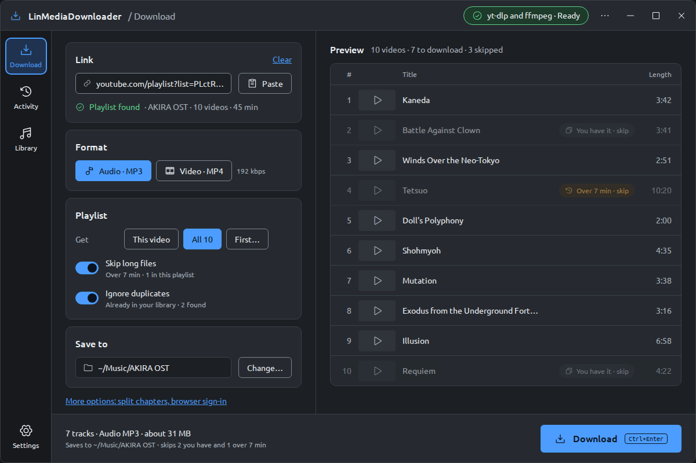
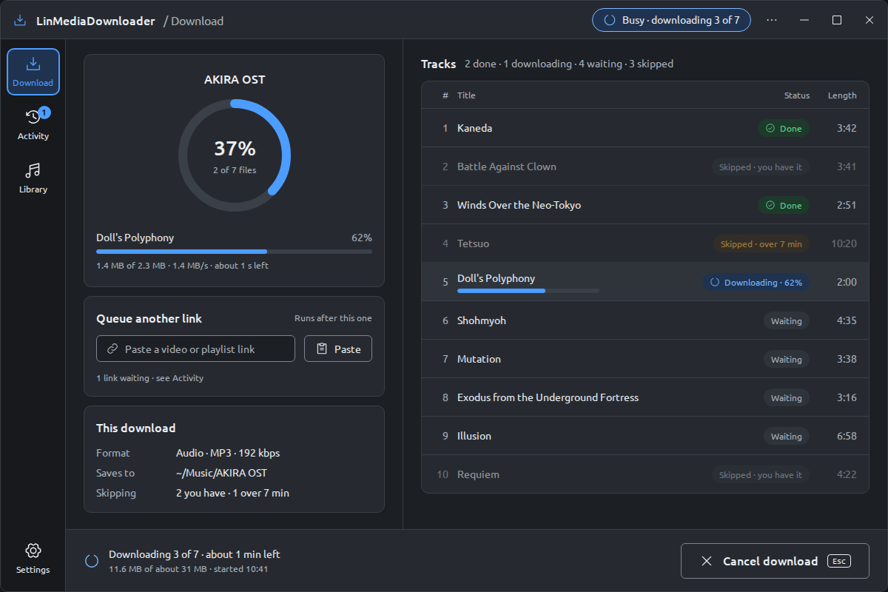
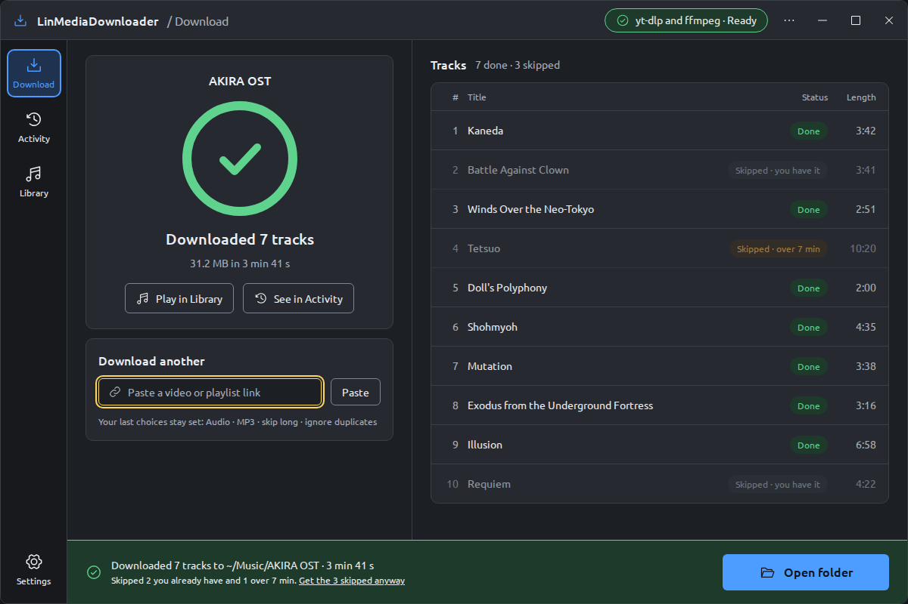
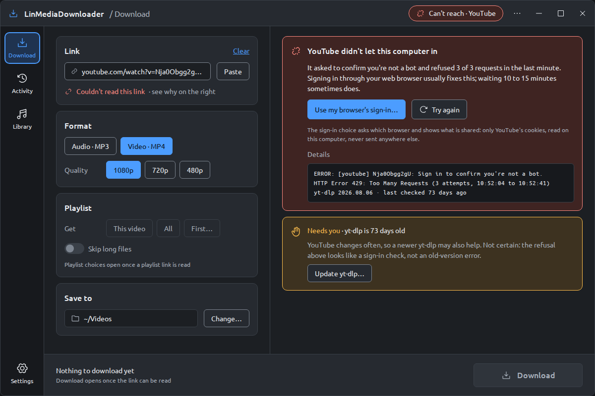
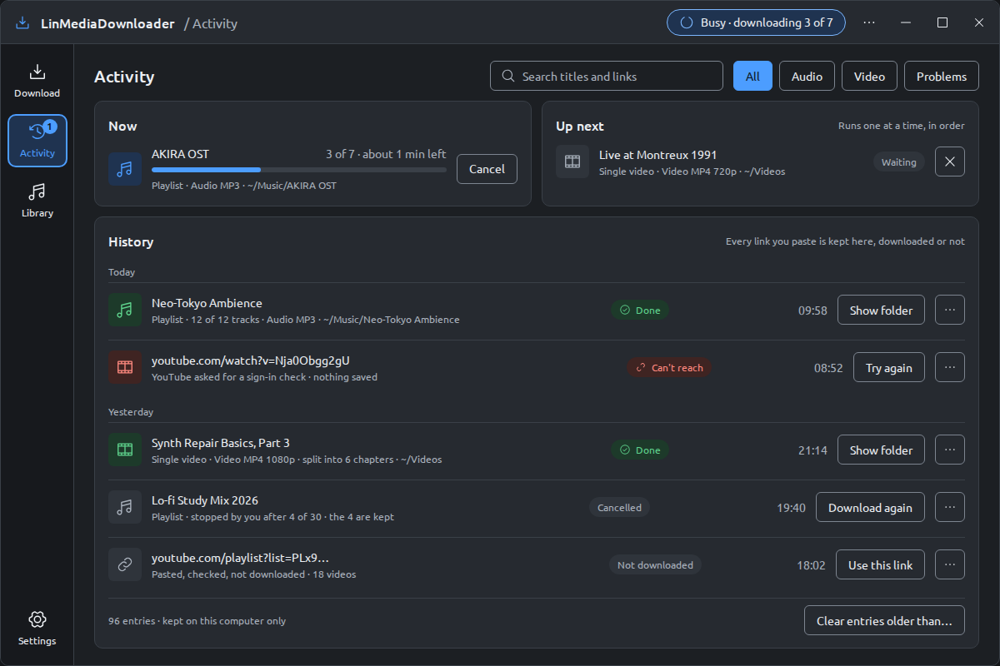
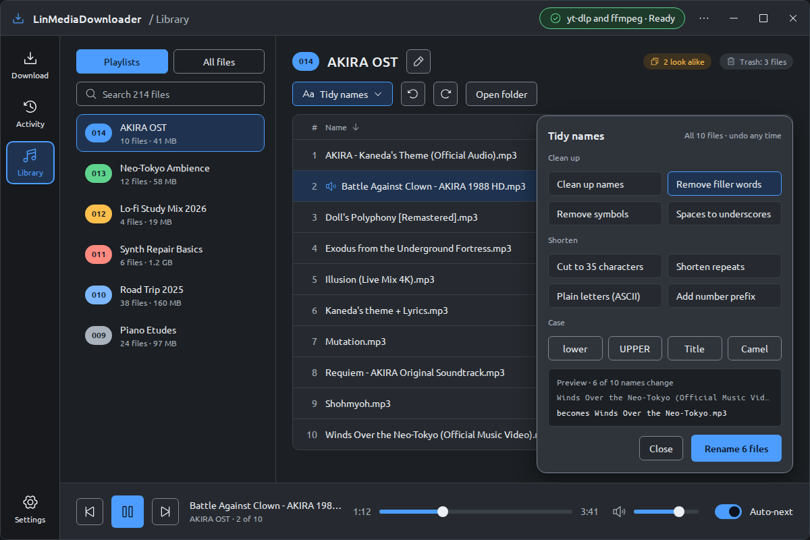
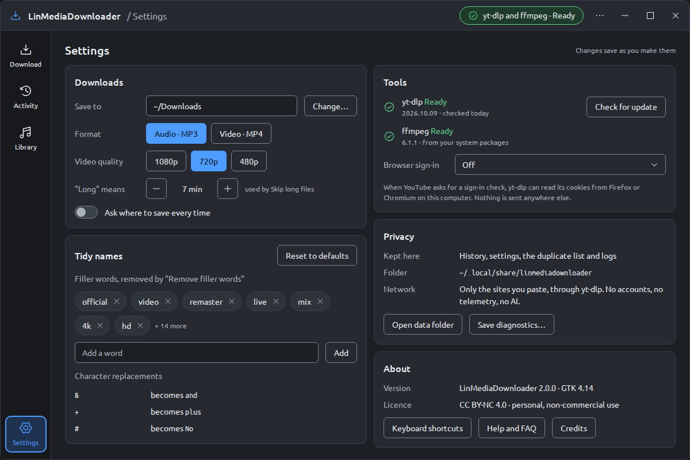
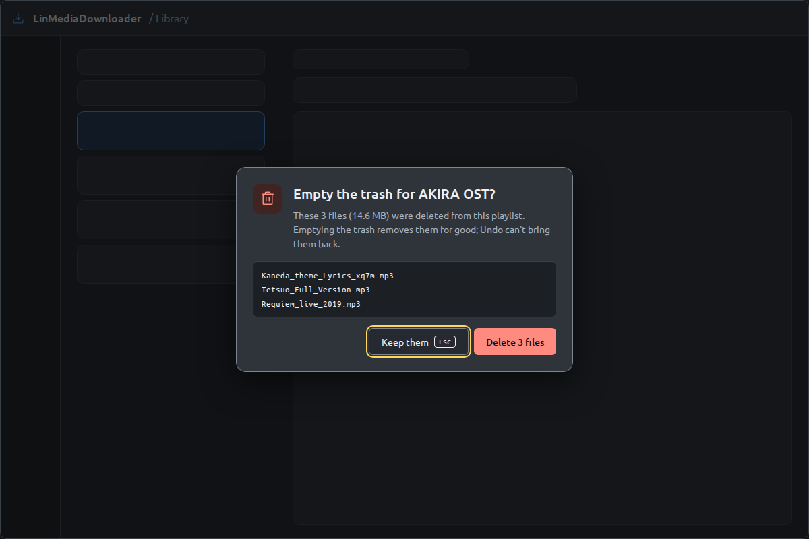
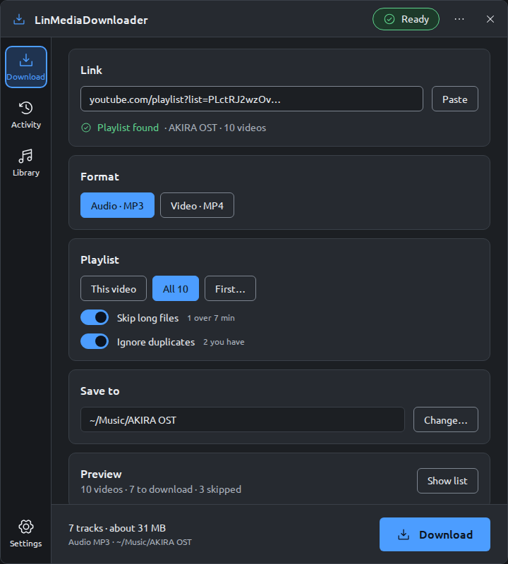

# 2.0 mockups: GTK 4, Graphite Night

The design for version 2.0, a native GTK 4 rewrite. These are mockups: the shipping app is still
1.x until the `feat/2.0-gtk4` branch is merged. The plan, the decisions and how each part maps
to GTK 4 widgets are in [../GTK4-UPGRADE-PLAN.md](../GTK4-UPGRADE-PLAN.md).

- Theme: Graphite Night, colours from `lintheme/tokens.py` (LinAppTemplate)
- Icons: Phosphor regular; font: Ubuntu
- Rules: [GUI Guide and Design Reference](https://github.com/MensuraMedia/linapptemplate/blob/main/docs/design/GUI-GUIDE-AND-DESIGN-REFERENCE.md)
- Source: the `*.dc.html` files and `canvas.json` here (a claude.ai design canvas);
  `images/` holds the same screens rendered at 1200 × 800 (720 × 800 for the narrow window)

## Download

The one job of the app: a link, four groups of options, a live preview of what will be saved,
and one main action at the bottom right.

| Ready: playlist found | Downloading |
|---|---|
|  |  |
| Skipped items are marked in the preview before anything is downloaded. | The 1.x progress ring stays; each track shows its status in words; Cancel is as big as Download. |

| Finished | Can't reach the site |
|---|---|
|  |  |
| Says what was saved, where and how long it took, and why anything was skipped. | What happened, why and the next step; technical detail behind Details; Download disabled with the reason. |

## Activity, Library, Settings

| Activity | Library |
|---|---|
|  |  |
| Queue, history and links in one place (1.x: Pending, History, Links). | Playlists, all files and the player (1.x: Playlists, File Manager, Player); Tidy names previews every rename. |

| Settings | Confirm a destructive action |
|---|---|
|  |  |
| Defaults, tidy-name words, tools, privacy and About (1.x: Settings, FAQ, About). | Only destructive actions ask; the title is the question and the buttons are verbs. |

## Narrow window (720 px)

One column; the preview folds into a strip; the rail gets narrower.
